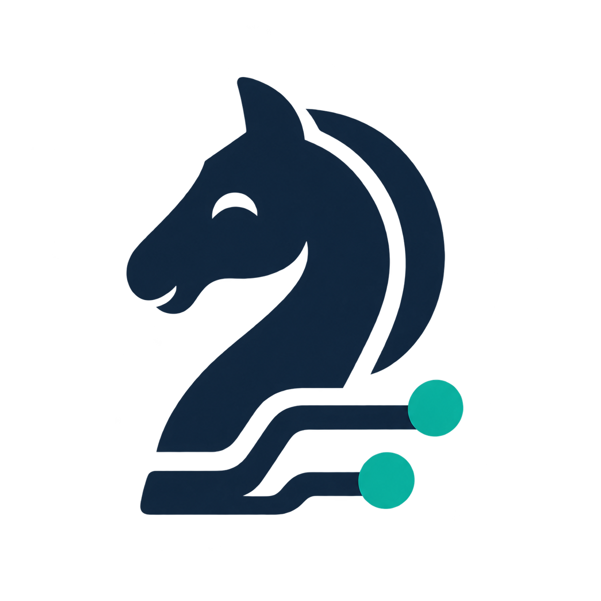

<p align="center">
  
</p>

# ChessBoardConnect

An independent Swift package for connecting electronic chessboards. Requires Swift 6, iOS 17+ or macOS 14+. No external dependencies: Foundation, Combine, and Core Bluetooth are Apple frameworks. Tests can run on macOS without an iPhone; full position and light validation still requires the physical board.

All project documentation, app text, diagnostic messages, and examples are written in English.

## Use in another app

In Xcode, choose **Add Package Dependencies**, enter `https://github.com/gvlcek/ChessBoardConnect`, and select the `main` branch. Link the `ChessBoardConnect` library product to your target. In a consuming Swift package:

```swift
// Package.swift
.package(url: "https://github.com/gvlcek/ChessBoardConnect.git", branch: "main")
// In the target's dependencies:
.product(name: "ChessBoardConnect", package: "ChessBoardConnect")
```

You can also use a local checkout with `.package(path: "../ChessBoardConnect")`. This is an early project; APIs may change before 1.0. Keep the resolved dependency revision under version control.

The host app must declare `NSBluetoothAlwaysUsageDescription` in its Info.plist. A sandboxed macOS app must also enable the Bluetooth entitlement. The package includes no UI and requests Bluetooth permission only when discovery is started.

```swift
import ChessBoardConnect
import Combine

@MainActor
final class MyBoardModel {
    let connect = BoardConnect()
    private var subscriptions = Set<AnyCancellable>()

    init() {
        connect.$position.sink { position in
            // nil means that no current reading is available.
            print(position?.fen ?? "No position")
        }.store(in: &subscriptions)

        connect.$state.sink { print($0) }.store(in: &subscriptions)
    }

    func search() { connect.scan() }
    func select(_ board: BoardDevice) throws { try connect.connect(board.id) }
    func guideE4() throws {
        guard connect.capabilities.contains(.controlLights) else { return }
        try connect.send(.setLights([BoardPosition.index("e2")!, BoardPosition.index("e4")!]))
    }
}
```

SwiftUI apps can observe `BoardConnect` with `@StateObject` and its published properties. Each subscriber receives updates independently; there is no single position callback that another screen could accidentally replace.

## Contract

- `devices`: discovered compatible devices, including identity, name, signal strength, and capabilities.
- `findConnectedBoards(namePrefix:)`: discover supported peripherals already connected to iOS, including those held by another app. `scan()` remains the advertisement path. Missing RSSI is represented as 127 (unavailable).
- `state`: typed states for scanning, connecting, receiving, disconnecting, and failure. `status` provides a diagnostic description.
- `position`: the placement of all 64 squares, normalized as the first FEN field. It does not infer the turn, castling rights, or legality.
- `lastMove`: the last move reported by a driver that emits moves. The Chessnut driver delivers positions and does not infer moves. The ChessUp driver delivers move events without claiming a sensor position.
- `capabilities`: whether the connected board supports reading positions, controlling lights, sending moves, or loading positions.
- `events`: live typed connection/position/move events and manufacturer protocol confirmations. `submit` returns a command correlation UUID; protocol confirmation is separate from physical completion.
- `send`: common commands. Throws `unsupportedCapability` when the connected driver does not provide the requested operation. A successful return means the command was queued, not that a person moved the pieces.
- `showLights` / `refresh`: shortcuts for the corresponding commands.
- `disconnect`, `reconnect`, `stopScan`: explicit connection lifecycle. Disconnecting discards the current position and pending commands. Reconnecting requires a new reading.
- `logs`: up to 200 diagnostic events, without persistent storage. Timestamps use ISO 8601.
- `clearLogs()`: clears recorded events without disconnecting or changing readings. `BoardDiagnostics` offers the same method and retains its selected device and GATT snapshot. New events continue to be recorded.

Public square indices run from a8=0 to h8=7, then down to a1=56 through h1=63. Use `BoardPosition.index("e4")` to avoid depending on this numbering. Passing `[]` to the lights command turns all lights off. Updates are published on MainActor. Errors are reported through `ConnectError` or `state.failed`; an invalid incoming reading invalidates the current position.

## Board support

| Driver | Status | Current capabilities |
| --- | --- | --- |
| Classic Chessnut | Go basic hardware flow verified: position after e2e4 and e2/e4 lights on/off | Read positions, control lights |
| ChessUp / ChessUp 2 | ChessUp 2 basic study flow verified: FEN, receive e2e4, send e7e5 with board lights, receive physical e7e5 | Receive moves, send moves, load full FEN |

The classic registry recognizes Chessnut names and explicitly excludes Move and Evo, which must not receive this protocol based only on the brand name. Go is the target for physical testing; compatibility with every classic firmware version is not guaranteed.

## Future board support

I'd love to support more electronic chessboards in the future. I currently own a **Chessnut Go** and a **ChessUp 2**, so these are the two boards I can test with directly.

If you own another board, have protocol documentation, or would like to help add or test support for a new model, I'd be happy to hear from you. You can reach me at [gvlcek@icloud.com](mailto:gvlcek@icloud.com).

## Unified move guidance

`BoardGuidance` adds an optional workflow above the existing connection: prepare a session, guide one move with its expected resulting position, and observe typed progress/completion. The consuming app does not branch on Chessnut versus ChessUp. The expected position comes from the app's chess logic; no PGN parser or chess engine is included.

```swift
let guidance = BoardGuidance(connect: connect) // Retain alongside the connection.
try guidance.prepareSession(fen: initialFullFEN)
// After guidance.state becomes .ready:
let requestID = try guidance.guideMove(move, expectedPosition: positionAfterMove)
```

On Go, guidance compares fresh sensor readings and updates difference lights. On ChessUp, it uses the move/FEN protocol and distinguishes protocol acceptance from a matching physical move report. Completion includes its evidence; move-reporting boards do not claim a sensor position. While guidance owns the connection, raw command submission is blocked. Cancellation may close a move-protocol board's local connection.

See [the move guidance guide](docs/MoveGuidance.md) for a complete example, state semantics, cancellation, and the shared test-app procedure. This workflow is new on `main`, is not part of the existing `0.1.0` tag, and still requires end-to-end hardware validation.

## Add another board

All changes belong inside this package:

1. Implement an internal `BoardDriver`: capabilities, Bluetooth profile, initial commands, command encoding, and notification decoding.
2. Add a factory and name filter to `DriverRegistry.standard`. Each connection creates a new driver, so buffers and protocol state are not shared.
3. Emit normalized `position` / `move` events. A driver can respond to the board through `write` events. Extend the handshake or transport inside the module if the hardware requires a different negotiation.
4. Add protocol fixtures and validate with real hardware. Consumer apps keep using the same interface and checking capabilities.

`BoardConnect` is the public facade, `BluetoothSession` handles transport, and drivers understand manufacturer messages. UUIDs, characteristics, and Bluetooth packets do not appear in the public interface. `BoardGuidance` coordinates a move supplied by the app, including hardware-specific cues and completion detection. PGN import, chess rules, computing target positions, game catalogs, and advancing a game's move cursor belong to the consuming app.

The package is independent of any consuming app. Add it using Swift Package Manager or a local checkout.

## Independent test app

[`Examples/ConnectTestApp`](Examples/ConnectTestApp/README.md) contains an iPhone Xcode project that consumes the local package. It can scan for and connect to boards, inspect positions and capabilities, light up squares, reconnect, and export logs. It has no dependency on a host app or game-study logic.

Open `Examples/ConnectTestApp/ConnectTestApp.xcodeproj`, create the ignored local signing configuration described in the example guide, and run on a physical iPhone. The example's guide includes a hardware checklist. Recommended workflow: package tests → test app with a physical board → integration in your own app.

## What consuming apps include

The only public Swift Package Manager product is the `ChessBoardConnect` library. Its production target contains the files under `Sources/ChessBoardConnect` and has no dependency on the example app or its support code.

| Usage | Included in the build |
| --- | --- |
| Add the library to your app | `ChessBoardConnect` and its Apple framework dependencies |
| Clone this repository and open the example Xcode project | The separate iPhone test app, which consumes the library |
| Run `swift test` in this repository | The library tests and the example view-model/report-export tests |

Swift Package Manager may fetch the entire source repository, including `Examples/`. Those files being present in a checkout does not make the example an installed app, an exported product, or part of a consuming app's binary. Dependency test targets are not part of the library product either. To run the test app, explicitly open its Xcode project from a clone of this repository.

## Driver-independent BLE diagnostics

`BoardDiagnostics` provides an optional metadata-only inspection API. It can inspect a selected device's GATT services and characteristic properties before a game driver exists. By default it includes all candidates, including unnamed devices; `BoardDiagnostics(namePrefix: "ChessUp")` limits results from both discovery paths to a case-insensitive peripheral/local name prefix. The filter uses current discovery identifiers rather than pinning a particular board UUID.

`checkConnectedDevices()` separately queries system-connected Nordic UART peripherals, including devices connected by other apps. This is useful when advertisement scanning does not find a board that the official app can connect to. It does not enumerate all paired Bluetooth devices, and UART is not unique to ChessUp. `BLEDiagnosticDevice.source` distinguishes these candidates from advertisements; missing advertisement metadata and RSSI are not invented. GATT inspection still requires a local connection.

It does not expose characteristic value reads, writes, notification subscriptions, or game commands. The public snapshots contain plain Swift values, not Core Bluetooth objects. Disconnected snapshots are retained for export; the connection state remains separate from inspection completion. `selectForReport` can capture an advertisement without connecting, including advertisements marked non-connectable.

The test app's **ChessUp** screen now uses `BoardConnect` and the experimental ChessUp driver. The metadata-only API remains reusable for future boards. See the [test app guide](Examples/ConnectTestApp/README.md#chessup-study-protocol-experimental) for the explicit FEN/start handshake, protocol acknowledgment handling, promotion update semantics, and physical validation procedure. `ready` means BLE writes and notifications are available; a ChessUp move also requires an explicitly initialized study session. `send` returning successfully means queued; status/logs record protocol confirmations. Missing protocol replies time out and disconnect rather than silently retrying moves. The package does not expose raw manufacturer commands to consumer apps. No game engine, legality checks, or sensor positions are inferred by the ChessUp driver.

## Tests

```sh
swift test
```

Tests cover known protocol bytes, orientation, fragmented packets, invalid input, disconnected-command behavior, multiple subscribers, registration of an additional test driver, and unified guidance with typed confirmations, cancellation, promotions, and stable sensor matching. Tests do not turn on Bluetooth. No code from the Chessconnect extension has been incorporated.

Classic protocol sources:

- [Manufacturer documentation](https://github.com/chessnutech/Chessnut_eBoards)
- [Official SDK implementation](https://github.com/chessnutech/EasyLinkSDK/blob/main/sdk/EasyLink.cpp)

The lights command uses 10 bytes, matching the manufacturer's SDK code. Its README is ambiguous: it mentions 34 bytes while showing a 10-byte command. Basic e2/e4 light control has been verified on one Go. Other firmware versions and the complete hardware checklist remain unverified.

## Contributing

See [CHANGELOG.md](CHANGELOG.md) for released versions and unreleased changes.

See [CONTRIBUTING.md](CONTRIBUTING.md) for checks and hardware reports, and the [test app guide](Examples/ConnectTestApp/README.md) for hardware validation steps and current limitations. CI runs package tests (including the example view model and report exporter) and an unsigned iPhone example build on macOS.

## License

[MIT](LICENSE) · Copyright 2026 Guadalupe Vlček.
